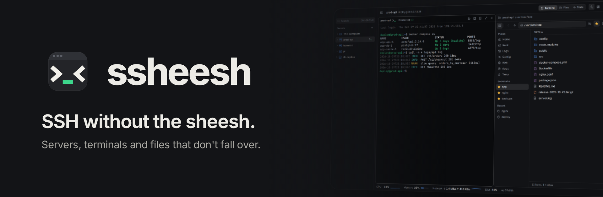

<div align="center">



[](https://github.com/footprintsntrails/ssheesh/releases/latest)
[](https://github.com/footprintsntrails/ssheesh/actions/workflows/ci.yml)
[](LICENSE)


[**Download**](https://github.com/footprintsntrails/ssheesh/releases/latest) · [Install on macOS](docs/install-macos.md) · [Install on Windows](docs/install-windows.md) · [Request a feature](https://github.com/footprintsntrails/ssheesh/issues/new/choose)

</div>

> [!WARNING]
> **Version 0.1.0 is a very early, raw preview.** Plenty is missing and things will break. Try it, and [say what's wrong](https://github.com/footprintsntrails/ssheesh/issues/new/choose).

<p align="center"></p>

## Why

You open a terminal to a server, start something long (a deploy, a backup, an AI agent), the Wi-Fi blinks, and it's gone. SSHeesh keeps it alive and reconnects on its own, and puts files and server health right next to the terminal.

## Simple from the first minute

SSHeesh is made for people who'd rather not become Linux admins to look after a VPS or a homelab.

- **Add a server by typing `user@host`.** That's the whole setup. Servers you already have in `~/.ssh/config` are there on their own.
- **Errors in plain words.** Instead of `Permission denied (publickey)` you read "The server didn't accept your login. Check the user name and key", with a button that helps.
- **No commands to memorize.** Click a container to get a shell inside it. Click Logs or Config in the file manager. Right-click anything to see what you can do with it.
- **Nothing to install on the server.** Stats come straight from Linux. Install `tmux` if you want sessions that survive disconnects; SSHeesh tells you when it would help.
- **Good defaults, easy undo.** It looks and works fine untouched. When you do tweak things, every section of Settings has a Reset.

## What it does

**Terminals that survive a bad network.** When the connection drops, SSHeesh reconnects by itself. On servers with `tmux`, you land back in the very same shell with everything still running. Close the app, open it tomorrow, and your sessions are still there.

<p align="center"></p>

**A file manager that's nice to use.** An address bar you can type into, filter, sort, bookmarks for the folders you live in (in a wide, narrow or hidden column), recent folders, one-click places like Logs and Config. Preview and edit text files in place. Drag files from your desktop to upload; download files or whole folders. Open a terminal in any folder, or browse the folder your terminal is in.

<p align="center"></p>

**Your containers, right in the sidebar.** Expand a server to see its Docker and Podman containers, grouped by Compose project. Click one for a shell inside it; right-click to follow its logs, restart, stop or start it. Container shells survive dropped connections too.

<p align="center"></p>

**Server stats without installing anything.** A one-line vitals bar (CPU, memory, network, disk) that hides with one click, and a detailed Stats view with load, traffic since boot (and this month, if the server runs `vnstat`) and every disk.

**Your layout, your colors.** Split panes any way you like and drag them around by their title bar. Ready-made layouts. Four app themes including a light one, accent colors, nine terminal color schemes, fonts, cursor, spacing. Sidebar on either side.

<p align="center"></p>

<p align="center"></p>

**Plays well with what you have.** It uses your normal `ssh`, so hosts from `~/.ssh/config`, your keys and your agent just work. Updates install themselves.

## Install

| | |
| --- | --- |
| **macOS** 11+ (Apple Silicon and Intel) | [Guide](docs/install-macos.md) · download the `.dmg` |
| **Windows** 10 / 11 | [Guide](docs/install-windows.md) · download the `setup.exe` |
| **Linux** | download the `.AppImage` or `.deb` |

All files are on the [Releases page](https://github.com/footprintsntrails/ssheesh/releases/latest). The app isn't signed by Apple or Microsoft yet, so the first launch needs a few extra clicks: on a Mac you allow it once in System Settings → Privacy & Security. The guides show every step.

**On your servers:** any Linux works. Install `tmux` for sessions that survive disconnects, optionally `vnstat` for monthly traffic.

## Keyboard

| | macOS | Windows / Linux |
| --- | --- | --- |
| Jump to anything | ⌘K | Ctrl+Shift+K |
| Split right / down | ⌘D / ⇧⌘D | Ctrl+Shift+D / Ctrl+Shift+E |
| Close pane | ⌘W | Ctrl+Shift+W |
| Show / hide sidebar | ⌘B | Ctrl+Shift+B |
| Show / hide server vitals | ⌘J | Ctrl+Shift+J |
| One pane fills the window, and back | ⇧⌘↩ | Ctrl+Shift+Enter |
| Settings | ⌘, | Ctrl+, |

## Ideas and bugs

Feature requests are very welcome: [open one](https://github.com/footprintsntrails/ssheesh/issues/new?template=feature_request.yml). SSHeesh is built to one vision, so pull requests aren't accepted; see [CONTRIBUTING.md](CONTRIBUTING.md).

## Build from source

You need [Node.js](https://nodejs.org) 22+, [Rust](https://rustup.rs) and the [Tauri prerequisites](https://tauri.app/start/prerequisites/).

```bash
npm install
npm run tauri dev      # run the app
npm run dev            # just the interface, in a browser, with sample data
npm run tauri build    # make an installer
```

| Path | What's there |
| --- | --- |
| `crates/sshee-core` | Rust core: hosts, sessions that reconnect, files, metrics. No UI. |
| `src-tauri` | The desktop app shell; exposes the core to the window. |
| `src` | The interface: React, Tailwind, xterm.js. |

Everything remote runs through the system `ssh` with connection sharing, so files and stats reuse the terminal's login. Durable sessions are named `tmux` sessions on the server.

## Roadmap

What's planned for the next releases. The order may still change.

- **0.2: fewer mistakes, nothing leaked.** Prod, Staging and Dev labels. A streamer mode that hides IPs and host names. A clear host key check. Passwords in your system keychain, plus support for 1Password, Bitwarden and KeePassXC agents. Highlighting in terminal output. A heads-up when an AI agent in a terminal needs you, and a "while you were away" summary after a reconnect.
- **0.3: commands and tunnels.** Snippets with variables, step-by-step recipes that explain every command, and a command palette with prefixes. Saved tunnels, and the server's web apps opening in your browser with one click.
- **0.4: Docker, files and disk.** Compose stacks with per-container stats, and updates you can roll back. "What's eating my disk", systemd services and a one-click security check-up. File transfers that pick up where they stopped after a dropped connection, and version history for config files.
- **0.5: workspaces and windows.** A workspace per project, panes in their own windows, a drop-down terminal and a tray monitor. App lock, importing from other SSH apps, and `ssh://` links.
- **0.6: sync and themes.** Encrypted sync through a folder you pick, with no account. Themes made from three colors, and theme sharing.
- **Along the way:** signed builds for macOS and Windows, and a built-in SSH connection on Windows, since its `ssh` can't share connections.

## Credits

Made by [@footprintsntrails](https://github.com/footprintsntrails), built together with [Claude](https://claude.com/claude-code) by Anthropic.

Terminal color schemes come from their open-source authors: Tokyo Night, Catppuccin, Dracula, Nord, One Dark, Gruvbox and Solarized.

## License

[CC BY-NC-SA 4.0](LICENSE). The code is open: you may use, study, share and modify SSHeesh for **non-commercial** purposes, as long as you credit the project and release anything you build on it under the same license, with its source open. Commercial use isn't allowed without permission.
