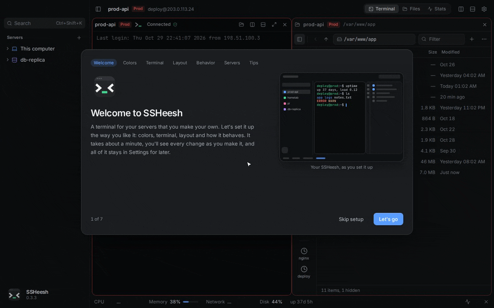
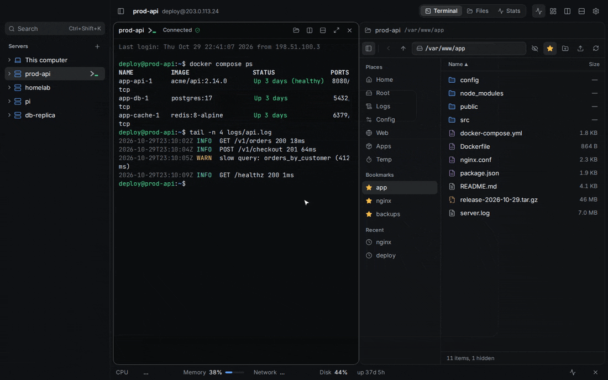
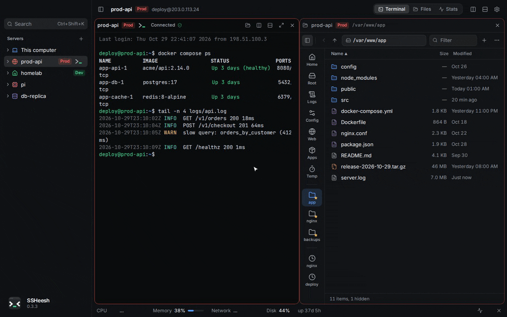
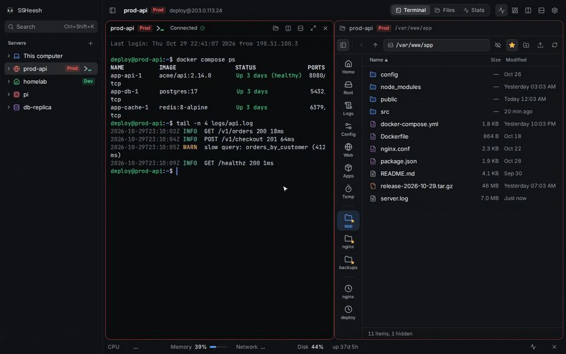
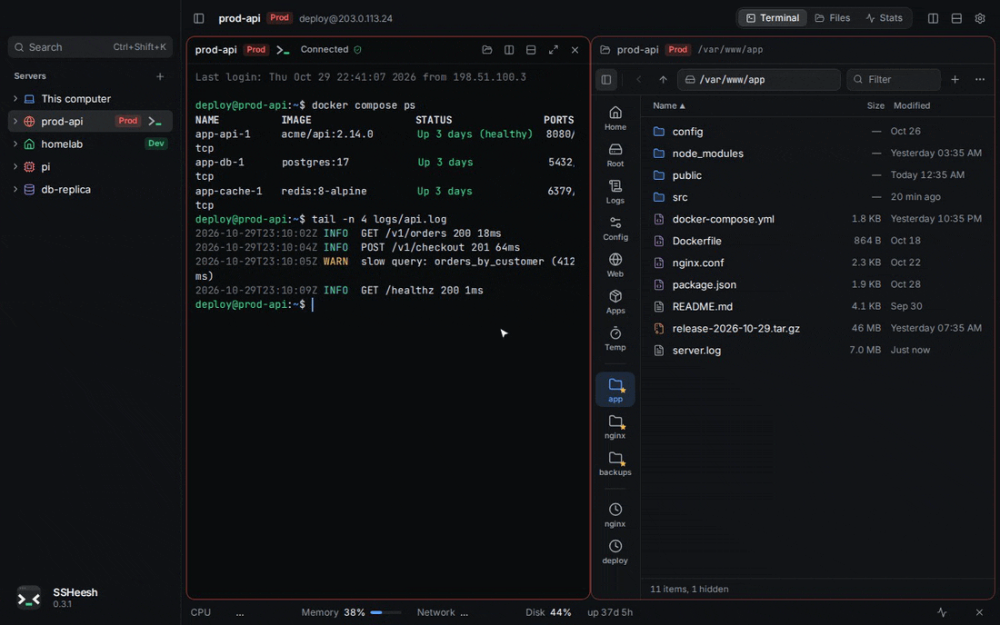
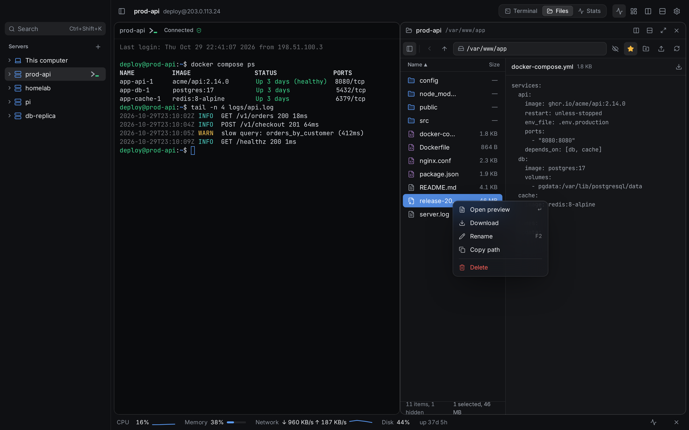
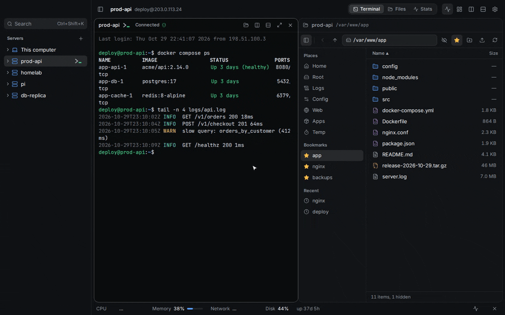
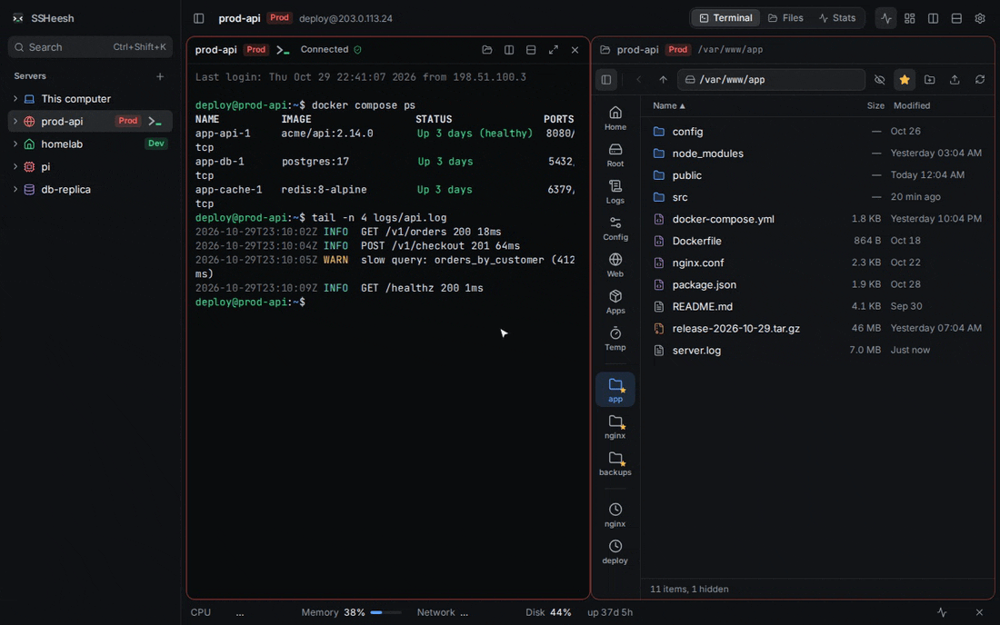

<div align="center">


[](https://github.com/footprintsntrails/ssheesh/releases/latest)
[](https://github.com/footprintsntrails/ssheesh/actions/workflows/ci.yml)
[](LICENSE)


[**Download**](https://github.com/footprintsntrails/ssheesh/releases/latest) · [Install on macOS](docs/install-macos.md) · [Install on Windows](docs/install-windows.md) · [Request a feature](https://github.com/footprintsntrails/ssheesh/issues/new/choose)

</div>

> [!WARNING]
> **Version 0.5 is an early preview.** Plenty is still missing and things will break. Try it, and [say what's wrong](https://github.com/footprintsntrails/ssheesh/issues/new/choose).

<p align="center"></p>

SSHeesh is a terminal for your servers that you make your own. Choose how it looks, down to an icon for each server. Keep files, stats and Docker containers next to your shell. And stop losing work to bad Wi-Fi.

## Simple from the first minute

SSHeesh is made for people who'd rather not become Linux admins to look after a VPS or a homelab.

- **A guided setup.** The welcome walks you through colors, the terminal, the layout and how SSHeesh behaves, with a live preview of every choice. Or skip it.
- **Paste and go.** Paste `root@1.2.3.4` or a whole `ssh -p 2222 -i key user@host` command, and every field fills in. Already have servers in `~/.ssh/config`? SSHeesh asks which ones you want.
- **Test before you add.** One click checks that the server answers, signs in, and has `tmux` for sessions that survive a dropped connection. If it doesn't, you get the command to install it.
- **Errors in plain words.** Instead of `Permission denied (publickey)` you read "The server didn't accept your login. Check the user name and key."
- **No commands to memorize.** Click a container to get a shell inside it. Click Logs or Config in the file manager. Right-click anything to see what you can do with it.
- **Good defaults, easy undo.** It looks and works fine untouched. When you do tweak things, Settings has a search box and every section has a Reset.

<p align="center"></p>

## Make it yours

Four app themes, or let the theme follow your system's light and dark mode. Accent colors, nine terminal color schemes, fonts, cursor, spacing, interface size. Give every server its own icon and color. Fold the sidebar into a rail of icons, or switch on compact mode and let everything but your panes slide away until you point at the window's edge.

<p align="center"></p>

Compact mode keeps just your panes on screen. Point at the window's edge and the server list or the toolbar slides in; move away and it's gone again.

<p align="center"></p>

Split panes any way you like and drag them around by their title bar. Fill the window with one pane, and fade the ones you're not using.

<p align="center"></p>

## Add a server in seconds

<p align="center"></p>

Your keys in `~/.ssh` and key managers like 1Password and Bitwarden are listed for you. Prefer a password? SSHeesh can remember it in your system keychain, never in its own files.

## Everything about a server in one window

**A file manager that's nice to use, and quick.** An address bar where every folder is a click away, filter, sort, back and forward with the mouse's side buttons, bookmarks for the folders you live in, recent folders, one-click places like Logs and Config. Preview and edit text files in place. Drag files from your desktop to upload; download files or whole folders. Every upload and download shows how far along it is and how fast it's going, with a button to stop it. Open a terminal in any folder, or send the one you're already using there.

<p align="center"></p>

**Your containers, right in the sidebar.** Expand a server to see its Docker and Podman containers, grouped by Compose project. Click one for a shell inside it; right-click to follow its logs, restart, stop or start it.

<p align="center"></p>

**Server stats without installing anything.** A one-line vitals bar (CPU, memory, network, disk) that hides with one click, and a detailed Stats view with load, traffic and every disk.

**A security check-up in one click.** SSHeesh looks at how people can log in, what's open to the internet, the firewall, Docker ports that slip past it, automatic updates, packages with security fixes waiting (with their CVE numbers), and protection against password guessing. It changes nothing. Each finding says in plain words why it matters, with a command to fix it that you can paste into the terminal.

**The server's web apps in your browser.** SSHeesh finds what the server serves, like Grafana or a dev server, and opens it at `localhost` with one click, through your SSH login. Keep tunnels you use often; they reconnect on their own.

**Recipes for the usual jobs.** Step-by-step guides to log in with a key, turn on the firewall, install Docker, add swap and more. Every command says what it does, and you run each one yourself.

**See where your disk space went.** How full each disk is, the biggest folders (click one to look inside), Docker's images and build cache, and old logs, with safe cleanups that each say what they remove.

## Made for long jobs and AI agents

**Sessions that survive a bad network.** On servers with `tmux`, a dropped connection doesn't end anything: SSHeesh reconnects (or asks first, your choice) and you land back in the very same shell. A card then shows what the server printed while you were away, with errors counted.

<p align="center"></p>

**It tells you when you're needed.** When Claude Code, Codex or any program in a terminal waits for an answer, or a long run goes quiet, the pane and the sidebar say so, and you get a system notification if SSHeesh is in the background.

<p align="center"></p>

**Start an agent where you are.** When Claude Code, Codex, OpenCode or oh-my-pi is installed on a server, its logo sits in the terminal's title bar. Click it to start the agent in the folder you're in, or in a new terminal beside yours if that one's busy. The terminal is tuned for them: full color, Shift+Enter for a new line, Esc that answers right away, and copying that reaches your clipboard.

**Problems jump out.** Errors show up in red and warnings in yellow, and you can add your own words to highlight. Ctrl+click a file path in the output to open it in the file manager.

**Snippets.** Keep the commands you run again, with blanks SSHeesh asks for, like which container. Type `cmd:` in the palette to find them.

## Safe by default

- **Prod, Staging and Dev labels** color a server's tag and frame everywhere it appears, so you know which machine you're typing into.
- **A clear question for new servers.** The first connection shows the server's fingerprint instead of ssh's yes/no prompt. If its identity ever changes, SSHeesh stops and shows the old and new fingerprints.
- **Streamer mode** hides server names, addresses, IPs and user names everywhere, terminal output included. One shortcut, before you share your screen.
- **Nothing phones home.** No account, no analytics. SSHeesh talks to your servers and to GitHub for updates, and Settings → Privacy says so.

<p align="center"></p>

**Plays well with what you have.** It uses your normal `ssh`, so hosts from `~/.ssh/config`, your keys and your agent just work. Updates install themselves.

## Install

| | |
| --- | --- |
| **macOS** 11+ (Apple Silicon and Intel) | One command in Terminal (below), or download the `.dmg` · [Guide](docs/install-macos.md) |
| **Windows** 10 / 11 | download the `portable.exe` and run it, nothing to install. Or the `setup.exe`. Both update themselves · [Guide](docs/install-windows.md) |
| **Linux** | download the `.AppImage`: one file, nothing to install. Make it runnable once (`chmod +x`), then double-click it. |

**Quickest on a Mac:** paste this into Terminal. It installs the latest version and opens it, with no security prompts:

```bash
curl -fsSL https://raw.githubusercontent.com/footprintsntrails/ssheesh/main/scripts/install-macos.sh | sh
```

All files are on the [Releases page](https://github.com/footprintsntrails/ssheesh/releases/latest). The app isn't signed by Apple or Microsoft yet, so the first launch needs a few extra clicks: on a Mac you allow it once in System Settings → Privacy & Security. The guides show every step.

**On your servers:** any Linux works. Install `tmux` for sessions that survive disconnects, optionally `vnstat` for monthly traffic.

## Keyboard

| | macOS | Windows / Linux |
| --- | --- | --- |
| Jump to anything (`srv:` `cmd:` `file:` `set:` narrow it down) | ⌘K | Ctrl+Shift+K |
| Split right / down | ⌘D / ⇧⌘D | Ctrl+Shift+D / Ctrl+Shift+E |
| Close pane | ⌘W | Ctrl+Shift+W |
| Show / hide sidebar | ⌘B | Ctrl+Shift+B |
| Show / hide server vitals | ⌘J | Ctrl+Shift+J |
| One pane fills the window, and back | ⇧⌘↩ | Ctrl+Shift+Enter |
| Compact mode | ⇧⌘M | Ctrl+Shift+M |
| Streamer mode | ⇧⌘H | Ctrl+Shift+H |
| Settings | ⌘, | Ctrl+, |
| Copy / paste in a terminal | ⌘C / ⌘V | Ctrl+Shift+C / Ctrl+Shift+V, or Ctrl+C with text selected. Ctrl+V pastes on Windows |
| New line in Claude Code, Codex, OpenCode | ⇧↩ | Shift+Enter |
| Scroll back in a terminal | ⇧Page Up / ⇧Page Down | Shift+Page Up / Shift+Page Down |
| Open a path or link from the terminal | ⌘-click | Ctrl+click |
| Back / forward in the file manager | Mouse side buttons, ⌥← / ⌥→ | Mouse side buttons, Alt+← / Alt+→ |

## Ideas and bugs

Feature requests are very welcome: [open one](https://github.com/footprintsntrails/ssheesh/issues/new?template=feature_request.yml). SSHeesh is built to one vision, so pull requests aren't accepted; see [CONTRIBUTING.md](CONTRIBUTING.md).

## Build from source

You need [Node.js](https://nodejs.org) 22+, [Rust](https://rustup.rs) and the [Tauri prerequisites](https://tauri.app/start/prerequisites/).

```bash
npm install
npm run tauri dev      # run the app
npm run dev            # just the interface, in a browser, with sample data
npm run tauri build    # make an installer
```

| Path | What's there |
| --- | --- |
| `crates/sshee-core` | Rust core: hosts, sessions that reconnect, files, metrics. No UI. |
| `src-tauri` | The desktop app shell; exposes the core to the window. |
| `src` | The interface: React, Tailwind, xterm.js. |

Everything remote runs through the system `ssh` with connection sharing, so files and stats reuse the terminal's login. Durable sessions are named `tmux` sessions on the server.

## Roadmap

What's planned next. The order may still change.

- **0.6: Docker, files and services.** Compose stacks with per-container stats, and updates you can roll back. systemd services. File transfers that pick up where they stopped after a dropped connection, and version history for config files.
- **0.7: workspaces and windows.** A workspace per project, panes in their own windows, a drop-down terminal and a tray monitor. App lock, importing from other SSH apps, and `ssh://` links.
- **0.8: sync and themes.** Encrypted sync through a folder you pick, with no account. Themes made from three colors, and theme sharing.
- **Along the way:** signed builds for macOS and Windows, and a built-in SSH connection on Windows, since its `ssh` can't share connections.

See what changed in each version in the [changelog](CHANGELOG.md).

## Credits

Made by [@footprintsntrails](https://github.com/footprintsntrails), built together with [Claude](https://claude.com/claude-code) by Anthropic.

Terminal color schemes come from their open-source authors: Tokyo Night, Catppuccin, Dracula, Nord, One Dark, Gruvbox and Solarized.

Icons in prompts like oh-my-posh and Starship come from the [Nerd Fonts](https://www.nerdfonts.com) symbols font (MIT; each icon set under its own open license).

## License

[CC BY-NC-SA 4.0](LICENSE). The code is open: you may use, study, share and modify SSHeesh for **non-commercial** purposes, as long as you credit the project and release anything you build on it under the same license, with its source open. Commercial use isn't allowed without permission.
