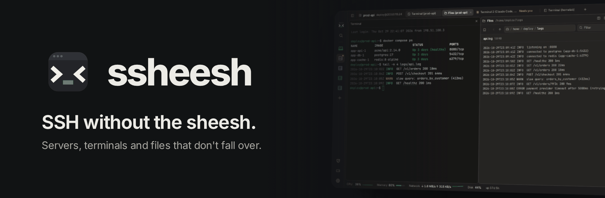
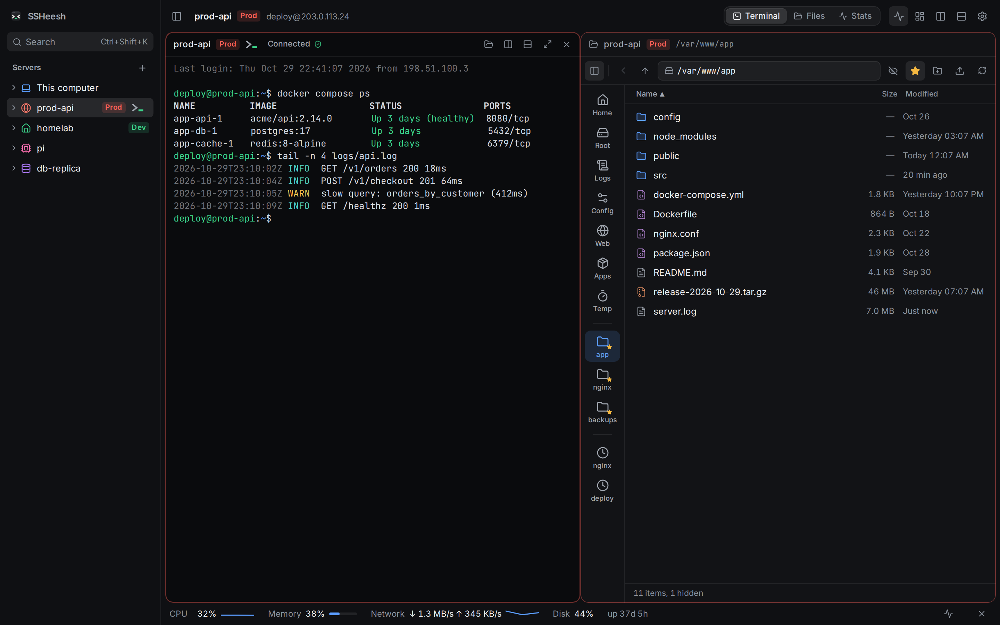
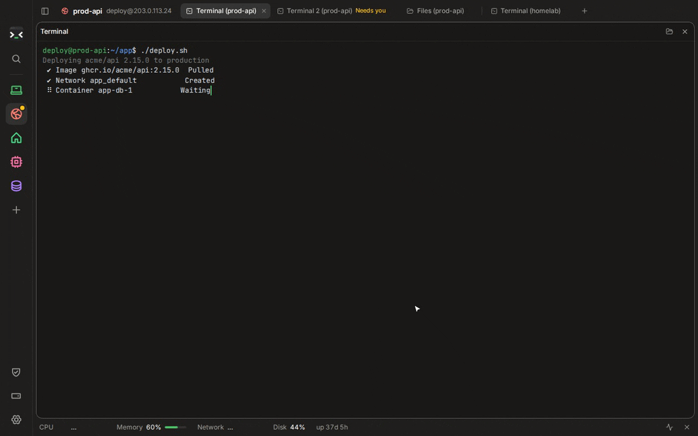
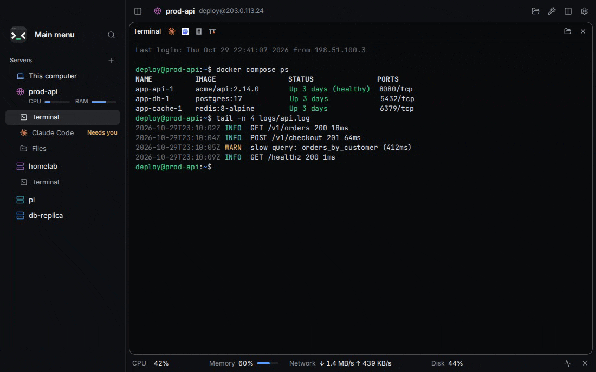
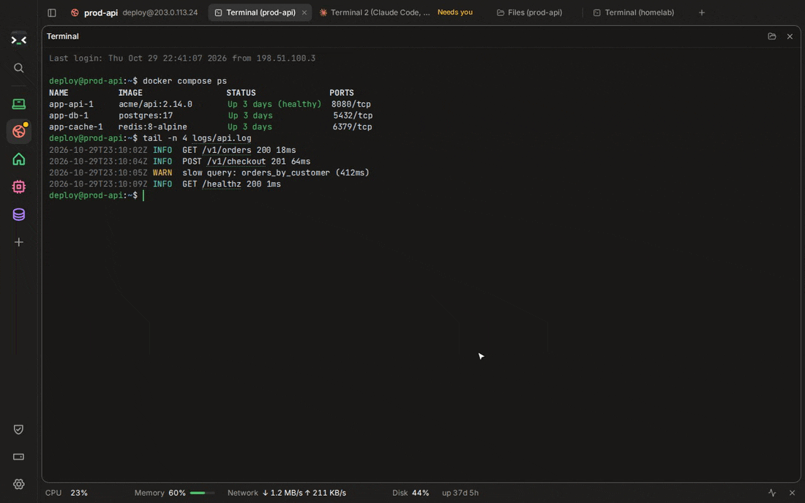
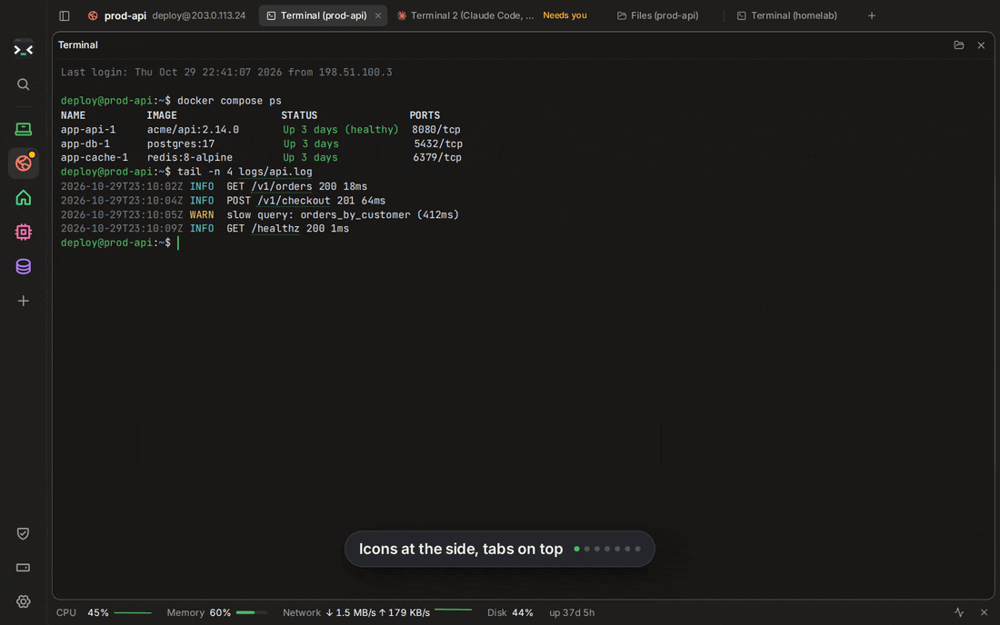
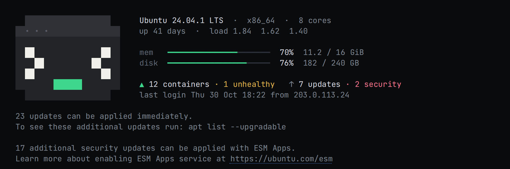

<div align="center">



[](https://github.com/footprintsntrails/ssheesh/releases/latest)
[](https://github.com/footprintsntrails/ssheesh/actions/workflows/ci.yml)
[](LICENSE)


[**Download**](https://github.com/footprintsntrails/ssheesh/releases/latest) · [Install on macOS](docs/install-macos.md) · [Install on Windows](docs/install-windows.md) · [Request a feature](https://github.com/footprintsntrails/ssheesh/issues/new/choose)

</div>

> [!WARNING]
> **Version 0.9 is an early preview.** Plenty is still missing and things will break. Try it, and [say what's wrong](https://github.com/footprintsntrails/ssheesh/issues/new/choose).

<p align="center"></p>

SSHeesh is a calm window for your servers: their terminals, files, containers and AI agents, laid out like a browser. Each server is like a site with tabs of its own, and the tabs of every server you have open sit in one row, each saying whose it is: “Files (web-1)”. It checks your servers' security and frees their disks with one click each.

## What makes it different

### Wi-Fi drops, your work doesn't

With `tmux` on the server, a dropped connection only pauses your view: the shell, the deploy, the agent keep running there. SSHeesh reconnects by itself and tells you what you missed, errors and warnings first. Uploads and downloads pick up where they stopped, and a terminal you haven't touched for 20 minutes lets go of its connection, then comes back with a key.

<p align="center"></p>

### Made for AI agents on your servers

Claude Code, Codex, OpenCode and OMP show up by name on their tab, like “Terminal 2 (Claude Code)”, and the server says “needs you” when one waits for an answer, with a notification if SSHeesh is in the background. Click any path an agent prints and the file opens beside it, at the lines it names (`app.ts:12-40`), Markdown nicely formatted.

<p align="center"></p>

### Secrets stay off your screen

Tokens, keys and passwords in a terminal's output show as dots before they're ever drawn, while the settings around them stay readable; click one to see it. **Streamer mode** goes further: server names, addresses and users disappear everywhere, terminal output included, and nothing can be shown until you turn it off. Share your screen or stream without a second thought.

<p align="center"></p>

### A security check-up and a tidy disk, one click each

The shield at the foot of the sidebar looks at password logins, root login, open ports, the firewall, Docker ports that go around it, updates, brute-force protection and a restart that's due, each in plain words. Looking changes nothing; a fix runs when you press **Run**, and you see how it went. When it needs you (sudo asks for your password), it opens in a terminal and says exactly what to type. The disk button beside it shows what fills each disk and the cleanups that are safe (Docker leftovers, old logs, package caches, old temporary files), each with how much it frees.

<p align="center"></p>

### Lay it out your way

Tabs on top or under each server, one tab at a time or several side by side, and a compact mode that hides the sidebar, the tab bar or both until you point at the window's edge. Mix them however you like.

<p align="center"></p>

## The idea

**Simple, and the screen is yours.** The terminal gets the room, and a button shows up when you reach for it, not before. Nothing to learn first: it reads like a browser.

**Your servers stay yours.** No account and no cloud: hosts, keys and passwords stay on your computer, and passwords live in your system's keychain. SSHeesh talks to your servers, and to GitHub to check for updates. Files you upload lose their metadata first (a photo's location and camera, a document's author); your own copy stays as it is.

**It's convenient from the first minute.** Paste a whole `ssh` command and every field fills in; your `~/.ssh/config`, keys and agent just work. Errors come in plain words, and every command SSHeesh suggests says what it does.

**You make it yours.** SSHeesh Default (a warm dark with a soft green), Midnight and three more themes you can edit down to every color, any accent color and your own terminal colors, your own keyboard shortcuts, icons in lines or pixels (in any color) or your own picture for every server, and the welcome a server greets you with. Change it all in the first minute, with a live preview, or later in Settings.

## Tricks worth knowing

- **Drag a tab onto the page** to see two at once, also two servers' tabs side by side; its × (or dragging it back to the tabs) makes it a tab again, still running. Ctrl+Shift+S switches between one tab at a time and side by side.

<p align="center"></p>

- **Copy files from one server to another.** Drag them from one server's Files onto another's beside it, or right-click them and pick the server and the folder there. They go straight through SSHeesh, so the servers don't need to reach each other, and nothing is replaced without asking.
- **A welcome that says where you are.** A new terminal shows the server's own welcome, or SSHeesh's: the system, uptime, memory and disk, containers and updates, beside the logo. The server's notices about updates always stay.

<p align="center"></p>

- **The main menu** (the logo at the top left) is a start page with all your servers, what's running and the tabs you closed. Ctrl+Shift+Z brings back the last one.
- **One bar for everything.** Ctrl+Shift+L (⌘L) finds servers, folders, commands and settings, and says which server a command runs on.
- **Your keys.** Every shortcut is listed in Settings → Keyboard, and you can change any of them.
- **Server icons that mean something.** SSHeesh sees what a server runs (a website, a database, Docker) and picks its icon; each server gets a color of its own. Right-click a server for 30 more, in lines or pixels, in any color.
- **Everything about a server, in its tabs:** a quick file manager with bookmarks, uploads and downloads (a download opens its folder with the file picked out), its Docker containers, stats, web apps opened through your SSH login, and step-by-step recipes for the usual jobs, whose steps run in the terminal with **Run**.

## Install

| | |
| --- | --- |
| **macOS** 11+ (Apple Silicon and Intel) | One command in Terminal (below), or download the `.dmg` · [Guide](docs/install-macos.md) |
| **Windows** 10 / 11 | Download `SSHeesh.exe` and run it, nothing to install. Or the `setup.exe`. Both update themselves · [Guide](docs/install-windows.md) |
| **Linux** | Download the `.AppImage`: one file, nothing to install. Make it runnable once (`chmod +x`), then double-click it. |

**Quickest on a Mac:** paste this into Terminal. It installs the latest version and opens it, with no security prompts:

```bash
curl -fsSL https://raw.githubusercontent.com/footprintsntrails/ssheesh/main/scripts/install-macos.sh | sh
```

All files are on the [Releases page](https://github.com/footprintsntrails/ssheesh/releases/latest). The app isn't signed by Apple or Microsoft yet, so the first launch needs a few extra clicks; the guides show every step.

**On your servers:** any Linux works. Install `tmux` for sessions that survive disconnects.

## Ideas and bugs

Feature requests are very welcome: [open one](https://github.com/footprintsntrails/ssheesh/issues/new?template=feature_request.yml). SSHeesh is built to one vision, so pull requests aren't accepted; see [CONTRIBUTING.md](CONTRIBUTING.md).

## Build from source

You need [Node.js](https://nodejs.org) 22+, [Rust](https://rustup.rs) and the [Tauri prerequisites](https://tauri.app/start/prerequisites/).

```bash
npm install
npm run tauri dev      # run the app
npm run dev            # just the interface, in a browser, with sample data
npm run tauri build    # make an installer
```

| Path | What's there |
| --- | --- |
| `crates/sshee-core` | Rust core: hosts, sessions that reconnect, files, metrics. No UI. |
| `src-tauri` | The desktop app shell; exposes the core to the window. |
| `src` | The interface: React, Tailwind, xterm.js. |

Everything remote runs through the system `ssh` with connection sharing, so files and stats reuse the terminal's login. Durable sessions are named `tmux` sessions on the server.

## Roadmap

What's planned next. The order may still change.

- **0.10: Docker and services.** Compose stacks with per-container stats, and updates you can roll back. systemd services, and version history for config files.
- **0.11: workspaces.** A workspace per project, a drop-down terminal and a tray monitor. App lock, importing from other SSH apps, and `ssh://` links.
- **0.12: sync.** Encrypted sync through a folder you pick, with no account.
- **Along the way:** signed builds for macOS and Windows, and a built-in SSH connection on Windows, since its `ssh` can't share connections.

See what changed in each version in the [changelog](CHANGELOG.md).

## Credits

Made by [@footprintsntrails](https://github.com/footprintsntrails), built together with [Claude](https://claude.com/claude-code) by Anthropic.

Terminal color schemes come from their open-source authors: Tokyo Night, Catppuccin, Dracula, Nord, One Dark, Gruvbox and Solarized.

Icons in prompts like oh-my-posh and Starship come from the [Nerd Fonts](https://www.nerdfonts.com) symbols font (MIT; each icon set under its own open license). Server icons are [Phosphor](https://phosphoricons.com) (MIT) and [pixelarticons](https://github.com/halfmage/pixelarticons) by Gerrit Halfmann (MIT).

## License

[CC BY-NC-SA 4.0](LICENSE). The code is open: you may use, study, share and modify SSHeesh for **non-commercial** purposes, as long as you credit the project and release anything you build on it under the same license, with its source open. Commercial use isn't allowed without permission.
