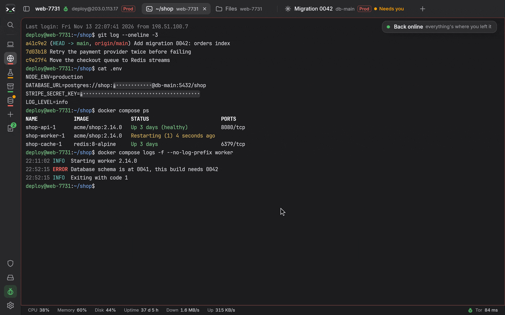
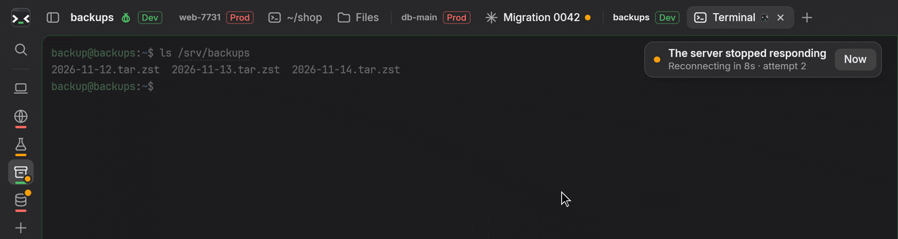
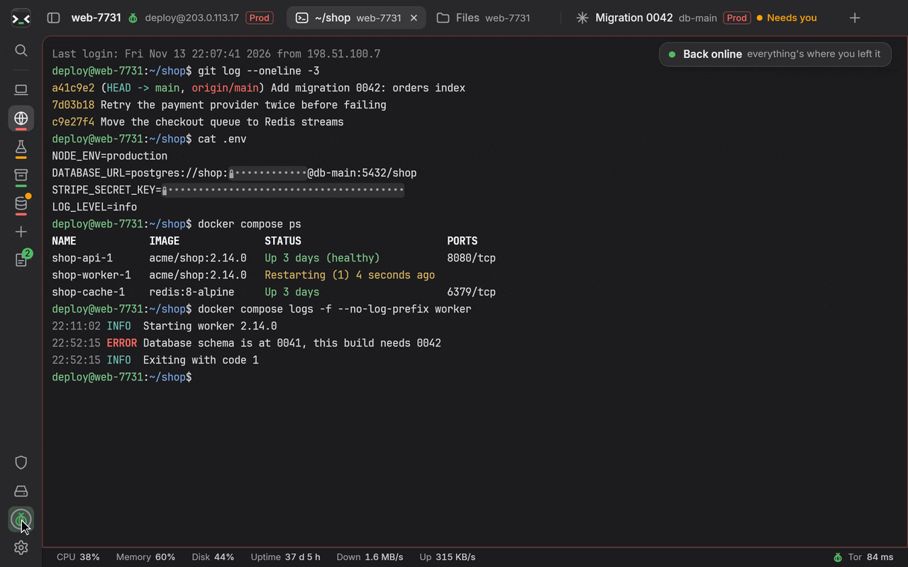
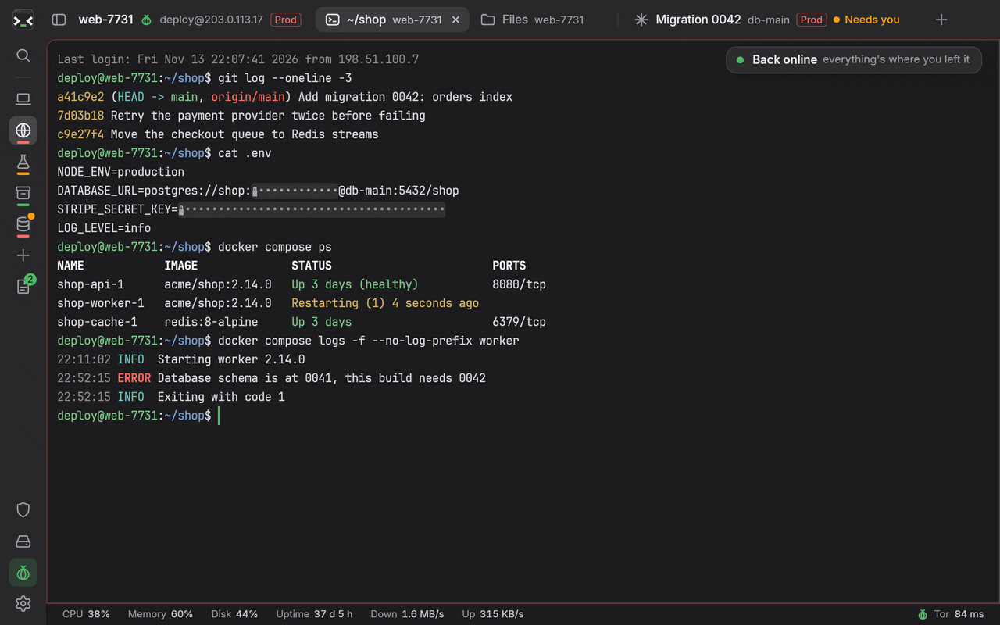
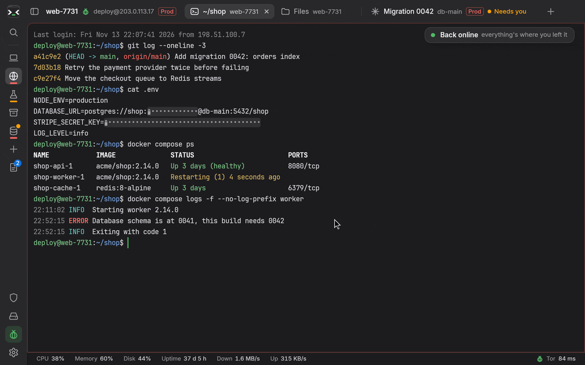
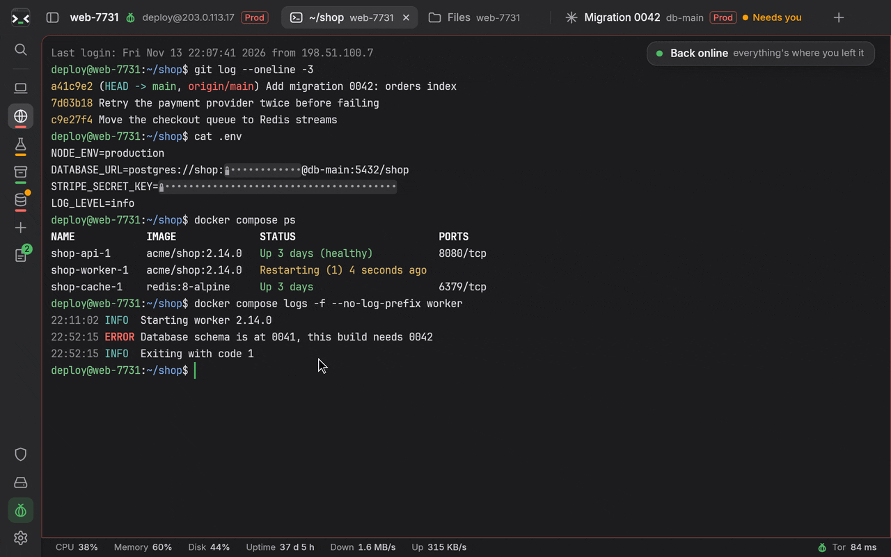
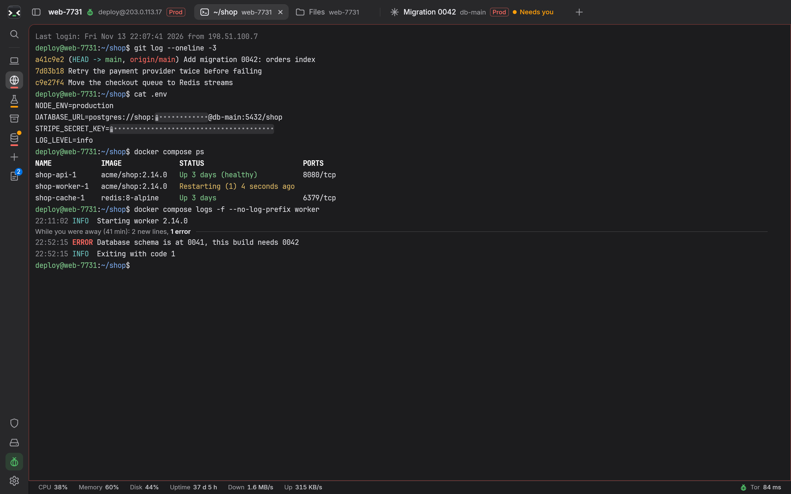
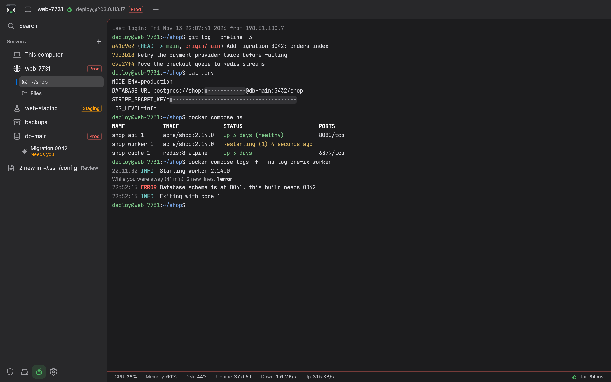
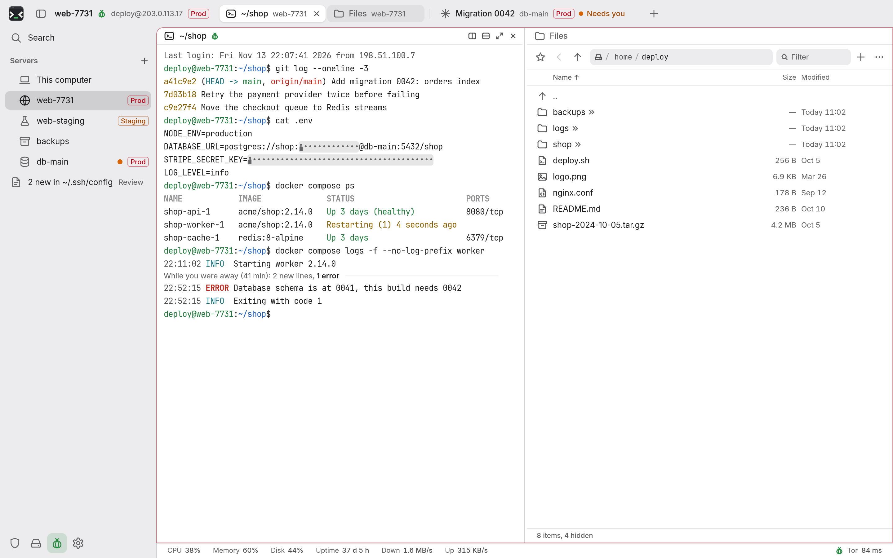

<div align="center">

_< face">

# SSHeesh

A free SSH client for your servers' terminals, files, containers and AI agents,<br>
laid out like a browser. For macOS, Windows and Linux.

[**Download 1.0**](https://github.com/footprintsntrails/ssheesh/releases/latest) · [Install](#install) · [What's new](CHANGELOG.md) · [Request a feature](https://github.com/footprintsntrails/ssheesh/issues/new/choose)

</div>

<p align="center"></p>

SSHeesh is a calm window for your servers, made for people who aren't infrastructure experts and for people who are. Each server is like a site with tabs of its own, and the tabs of every server you have open sit in one row, each with its server's name beside it. The terminal gets the room, and a button shows up when you reach for it, not before. It checks your servers' security and frees their disks with one click each, and with one more it hides where you connect from, through Tor. There's no account and no cloud.

## Wi-Fi drops, your work doesn't

A dropped connection doesn't end anything. When SSHeesh reconnects, the terminal is exactly as you left it: its whole history is still there, and what was running kept running on the server the whole time. An AI agent in the middle of a task, a deploy, a long build: nothing needs restarting, you just pick up where it is now. A line in the terminal says what you missed while you were away, such as how many new lines came and how many of them are errors. It works on any server with `tmux` installed. Uploads and downloads also pick up where they stopped.

<p align="center"></p>

<p align="center"></p>

## Made for AI agents on your servers

An agent you start in SSHeesh runs on the server, not on your computer. Close the laptop, lose the Wi-Fi, quit SSHeesh: it keeps working, and when you come back its whole session is there, history included, with nothing to restart. Claude Code, Codex, OpenCode and OMP show up by name on their tab, and the tab says “Needs you” when one waits for an answer, with a notification if SSHeesh is in the background. Point at that tab to read the question and answer it with a click, as in the picture at the top. Click any path an agent prints and the file opens beside it, at the lines it names (`app.ts:12-40`), Markdown nicely formatted.

## Connect through Tor, in one click

Press the onion above Settings and everything goes through Tor: terminals, files, stats and tunnels. Your servers and their logs see a Tor address instead of yours, and your internet provider sees Tor, not which servers you use. If Tor can't carry a connection, the connection isn't made: nothing slips around it, not even a name lookup. Tor is built in, so there's nothing to install, and terminals in `tmux` move over without losing their place.

<p align="center"></p>

It's also fast, for Tor. Before a server's first connection, SSHeesh times six Tor routes to it, three times each, and keeps the quickest; the status bar shows the round trip. In our tests from a datacenter a keystroke came back in 60 to 100 ms, a login took about a second, and no pick landed on a route slower than 400 ms. Your own connection adds its share. For that speed ssh doesn't hide your typing rhythm under Tor: your provider, Tor's relays and the server's network can see when you press keys, which can show how long a typed password is and hint at what you typed, though they can't read it. Settings → Tor hides it again, at about twice the delay per key.

## Find anything from one bar

Ctrl+Shift+L (⌘L on a Mac) finds servers, folders, commands, snippets and settings. A command for a server says which server it runs on, and is never picked for you: you move to it and press Return.

<p align="center"></p>

## Files beside the terminal

Each server has a quick file manager with bookmarks, uploads and downloads, and it shows pictures and Markdown where they are. Drag files onto a folder to move them, or out of the window to download them; nothing is replaced without asking.

<p align="center"></p>

- **Copy files from one server to another.** Drag them from one server's Files onto another's beside it, or right-click them and pick the server and the folder there. They go straight through SSHeesh, so the servers don't need to reach each other.
- **Open a server's file in your own editor.** Pick the editor in the file's menu; every save goes back to the server, and if the file changed there meanwhile, SSHeesh shows you before anything is overwritten.

## A security check-up and a tidy disk, one click each

The shield at the foot of the sidebar looks at password logins, root login, open ports, the firewall, Docker ports that go around it, updates, brute-force protection and a restart that's due, each in plain words. Looking changes nothing. Each fix shows the exact command first and runs only after you say yes, twice on a server labelled Production; when it needs you (sudo asks for your password), it opens in a terminal. The disk button beside it shows what fills each disk and the cleanups that are safe (Docker leftovers, old logs, package caches, old temporary files), each with how much it frees.

<p align="center"></p>

## Secrets stay off your screen

Tokens, keys and passwords in a terminal's output show as dots before they're ever drawn, while the settings around them stay readable; click one to see it. Streamer mode (Ctrl+Shift+H, ⇧⌘H) hides server names, addresses and users everywhere, terminal output included, while you share your screen.

## Lay it out your way

Tabs on top or under each server, one tab at a time or several side by side, and a compact mode that hides the sidebar, the tab bar or both until you point at the window's edge. Shift+click a server to open it in a window of its own. Mix them however you like.

<p align="center">


</p>

SSHeesh Default (a warm dark with a soft green), Daylight, Midnight, Graphite and OLED, each editable down to every color; any accent color and your own terminal colors; your own keyboard shortcuts; server icons in lines or pixels, in any color, or your own picture; and the welcome a server greets you with.

<p align="center"></p>

## More worth knowing

- **Bring your servers with you.** Your `~/.ssh/config`, keys and agent just work, and SSHeesh brings over your servers from SSHeesh 0.10, XPipe, PuTTY, MobaXterm and other SSH apps it finds.
- **Two tabs at once.** Drag a tab onto the page, also two servers' tabs side by side. Ctrl+Shift+S (⇧⌘S) switches between one tab at a time and side by side.
- **A welcome that says where you are.** A new terminal shows the server's own welcome, or SSHeesh's: the system, uptime, memory and disk, containers and updates, beside the logo. The server's notices about updates always stay.
- **The main menu** (the logo at the top left) is a start page with all your servers, what's running and the tabs you closed. Ctrl+Shift+Z (⇧⌘T) brings back the last one.
- **Your keys.** Every shortcut is listed in Settings → Keyboard, and you can change any of them.
- **Server icons that mean something.** SSHeesh sees what a server runs (a website, a database, Docker) and picks its icon; each server gets a color of its own. Right-click a server for 30 more icons in any color, or your own picture.
- **Everything about a server, in its tabs:** its Docker containers grouped by Compose project with their logs and a shell, stats, web apps opened in your browser through your SSH login, tunnels, and step-by-step recipes for the usual jobs, whose steps go into the terminal for you to run.

## Your servers stay yours

No account and no cloud: hosts, keys and passwords stay on your computer, and passwords live in your system's keychain. SSHeesh talks to your servers (through Tor, if you like), and to GitHub to check for updates. Files you upload lose their metadata first (a photo's location and camera, a document's author); your own copy stays as it is.

## Install

Download SSHeesh for your computer from the [Releases page](https://github.com/footprintsntrails/ssheesh/releases/latest).

| | Download | Then |
| --- | --- | --- |
| **Windows** (x64) | `SSHeesh_<version>_x64-setup.exe` | Run it: it installs SSHeesh for you, with a Start menu entry. Prefer no install? `SSHeesh.exe` runs from any folder. On the blue SmartScreen window choose “More info”, then “Run anyway”. |
| **macOS** (Apple Silicon) | `ssheesh-<version>-macos-arm64.tar.gz` | Double-click it and drag `SSHeesh.app` to Applications. The first time, right-click the app and choose Open. |
| **Linux** (x64) | `ssheesh-<version>-linux-x64.tar.gz` | `tar xzf ssheesh-*-linux-x64.tar.gz && ./ssheesh`. It draws with Vulkan, which Mesa's graphics drivers provide. |

SSHeesh updates itself from GitHub, the installed and the portable kind alike, or only tells you, as Settings → Updates says; SSHeesh 0.10 offers the update to 1.0 by itself. Builds aren't signed by Apple or Microsoft yet, which is why the first launch needs those extra steps. Try it without any real server: start it with `--demo`.

**On your servers:** any Linux works. Install `tmux` for sessions that survive disconnects.

## Build from source

You need [rustup](https://rustup.rs), which installs the Rust version named in `desktop/rust-toolchain.toml` on the first build. On Debian or Ubuntu, add these libraries and a Vulkan driver:

```bash
sudo apt install libxkbcommon-dev libxkbcommon-x11-dev libwayland-dev libdbus-1-dev pkg-config libvulkan1 mesa-vulkan-drivers
```

Then:

```bash
sh scripts/vendor-rune.sh                 # Rune, the window library, with SSHeesh's fixes
cd desktop
cargo run -p ssheesh-preview              # run the app
cargo run -p ssheesh-preview -- --demo    # on made-up servers, connecting to nothing
```

| Path | What's there |
| --- | --- |
| `crates/sshee-core` | The core: ssh, `tmux`, files, Tor, metrics. No window. |
| `crates/sshee-app` | The app's rules without a screen: servers, tabs, settings, what each screen does. |
| `desktop/sshee-ui` | Everything drawn, on Rune: the window, the terminal, every screen. |
| `desktop/app` | The program itself, on your servers or on made-up ones (`--demo`). |

Everything remote runs through the system `ssh`, with connection sharing where it can (not on Windows), so files and stats reuse the terminal's login. Durable sessions are named `tmux` sessions on the server. With Tor on, ssh hands each connection to SSHeesh's own Tor client, [Arti](https://gitlab.torproject.org/tpo/core/arti), through a `ProxyCommand`. How the window is built: [desktop/ARCHITECTURE.md](desktop/ARCHITECTURE.md).

## Roadmap

What's planned next. The order may still change.

- **Docker and services.** Per-container stats, and updates you can roll back. systemd services, and version history for config files.
- **Workspaces.** A workspace per project, a drop-down terminal and a tray monitor. App lock, and `ssh://` links.
- **Sync.** Encrypted sync through a folder you pick, with no account.
- **Along the way:** signed builds for macOS and Windows, and a built-in SSH connection on Windows, since its `ssh` can't share connections.

See what changed in each version in the [changelog](CHANGELOG.md).

## Ideas and bugs

Feature requests are very welcome: [open one](https://github.com/footprintsntrails/ssheesh/issues/new?template=feature_request.yml). SSHeesh is built to one vision, so pull requests aren't accepted; see [CONTRIBUTING.md](CONTRIBUTING.md).

## Credits

Made by [@footprintsntrails](https://github.com/footprintsntrails), built together with [Claude](https://claude.com/claude-code) by Anthropic.

The window is drawn by [Rune](https://github.com/anomalyco/rune) (MIT), with a few fixes of our own.

Terminal color schemes come from their open-source authors: Tokyo Night, Catppuccin, Dracula, Nord, One Dark, Gruvbox and Solarized.

Fonts are [JetBrains Mono](https://www.jetbrains.com/lp/mono/) and [Inter](https://rsms.me/inter/) (SIL Open Font License). Icons in prompts like oh-my-posh and Starship come from the [Nerd Fonts](https://www.nerdfonts.com) symbols font (MIT; each icon set under its own open license). Pixel server icons are [pixelarticons](https://github.com/halfmage/pixelarticons) by Gerrit Halfmann (MIT). The full list is in [desktop/THIRD-PARTY.md](desktop/THIRD-PARTY.md).

Tor comes from [Arti](https://gitlab.torproject.org/tpo/core/arti), the Tor Project's Tor in Rust (MIT or Apache 2.0). SSHeesh isn't made or endorsed by the Tor Project.

## License

[CC BY-NC-SA 4.0](LICENSE). The code is open: you may use, study, share and modify SSHeesh for **non-commercial** purposes, as long as you credit the project and release anything you build on it under the same license, with its source open. Commercial use isn't allowed without permission.
